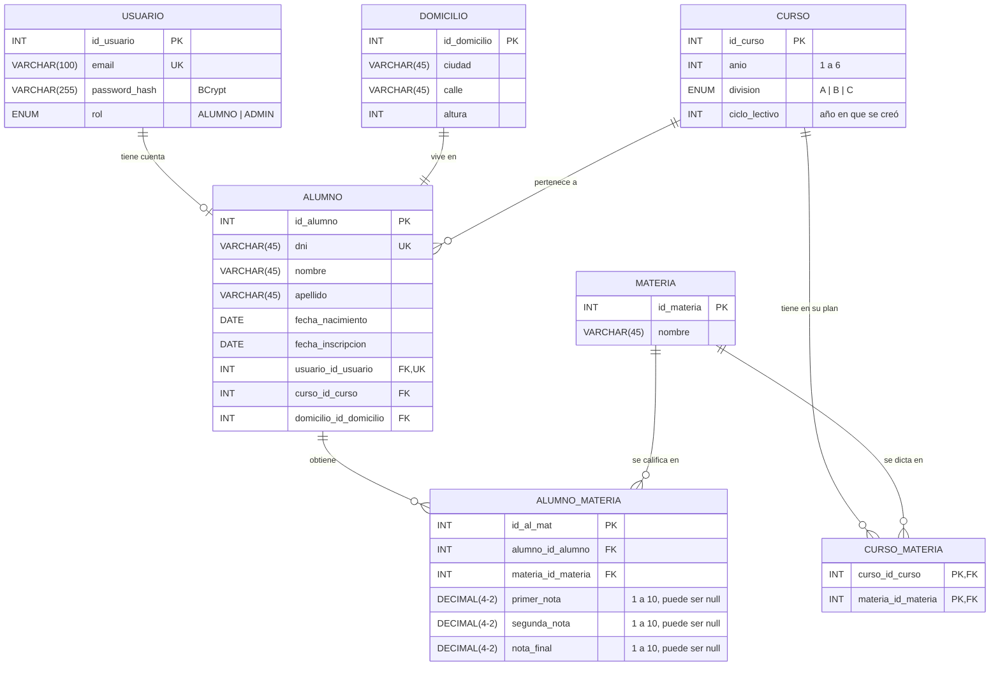

# Diagrama Entidad-Relación (DER)

Base de datos `jt_education_db_red` (MySQL). El script que la crea es [`bbd/Escuela_DDL.sql`](../bbd/Escuela_DDL.sql).

> Si cambia alguna tabla, hay que actualizar este documento junto con `Escuela_DDL.sql` y `datos_prueba.sql`.

## Diagrama

Notación "pata de gallo": `||` = exactamente uno, `o|` = cero o uno, `o{` = cero o muchos, `|{` = uno o muchos.

## Relaciones

El enunciado pide al menos una relación de cada tipo. Están todas:

| Tipo | Relación | Cómo se implementa en la base | Cómo se implementa en Java (JPA) |
|---|---|---|---|
| **1:1** | Alumno – Usuario | `alumno.usuario_id_usuario` es FK y `UNIQUE`: un usuario no puede ser de dos alumnos. Un usuario `ADMIN` no tiene alumno (por eso del lado del usuario es "cero o uno"). | `@OneToOne` en `Alumno.usuario` |
| **1:1** | Alumno – Domicilio | `alumno.domicilio_id_domicilio` es FK. | `@OneToOne(cascade = ALL)` en `Alumno.domicilio`: el domicilio se crea y se borra junto con su alumno. |
| **1:N** | Curso – Alumno | `alumno.curso_id_curso` es FK: muchos alumnos pertenecen a un curso. | `@ManyToOne` en `Alumno.curso` |
| **N:M** | Curso – Materia (plan de estudios) | Tabla intermedia `curso_materia`. Su clave primaria es la combinación de las dos FK, así una materia no se repite en un curso. | `@ManyToMany` + `@JoinTable` en `Curso.materias`. Como la tabla no tiene datos propios, no hace falta una entidad intermedia. |
| **N:M** | Alumno – Materia (notas) | Tabla intermedia `alumno_materia`, con `UNIQUE (alumno, materia)`. | Entidad `AlumnoMateria` con dos `@ManyToOne`. Es una entidad (y no un `@ManyToMany`) porque la relación **tiene datos propios**: las tres notas. |

**Sobre Alumno – Domicilio:** la 1:1 la garantiza la aplicación, porque cada alta de alumno crea su propio domicilio y nunca se reutiliza uno existente. A diferencia de `usuario_id_usuario`, la columna `domicilio_id_domicilio` no tiene `UNIQUE` en la base.

## Reglas que conectan las tablas

Estas reglas no se pueden expresar solo con claves foráneas; las controla la capa de servicios:

- **Las notas son solo de materias del plan del curso del alumno.** No se pueden cargar notas de una materia que no esté en `curso_materia` para el curso del alumno.
- **No se puede quitar una materia del plan** de un curso si algún alumno de ese curso tiene notas en ella.
- **No se puede cambiar de curso a un alumno que tiene notas**, porque quedarían notas de materias que el curso nuevo quizás no tiene.
- **No se repite un curso:** la combinación año + división + ciclo lectivo es única.
- **El ciclo lectivo lo asigna el sistema** (año actual) al crear el curso.

## Diagramas anteriores

En [`bbd/`](../bbd/) están los diagramas originales del diseño:

- `DER_Proyecto.drawio`: primer diseño, más grande (escuela, inscripciones, años). **No corresponde a la base actual.**
- `DER_REDUCIDO.drawio` y `Escuela_EER.mwb`: versión reducida, **sin la relación Curso – Materia** (`curso_materia`).

El diagrama de este documento es el que refleja la base actual.
