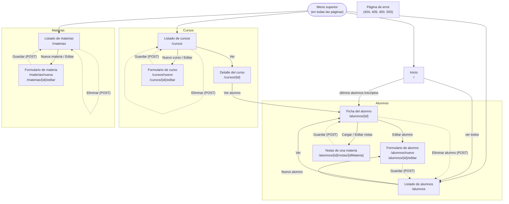

# Mapa del sitio

Páginas de JTEducation y cómo se navega entre ellas. El menú superior (Inicio, Alumnos, Materias, Cursos) está en todas las páginas, así que desde cualquiera se puede ir a las secciones principales.

> Si cambian las páginas o las rutas, hay que actualizar este documento.

## Diagrama de navegación

Las flechas indican un link o botón de una página a otra. Las acciones que modifican datos (guardar, eliminar) se envían por `POST` y, si salen bien, redirigen a la página indicada con un mensaje de confirmación.

Cualquier página puede terminar en la **página de error** si se pide algo que no existe (por ejemplo `/alumnos/999`, error 404) o si una operación viola una regla que no se puede mostrar en un formulario (error 409).

## Rutas

| Página | Método y URL | Vista (`templates/`) | Qué hace |
|---|---|---|---|
| Inicio | `GET /` | `index.html` | Muestra los 6 últimos alumnos inscriptos. |
| Listado de alumnos | `GET /alumnos` | `alumnos/list.html` | Lista paginada (10 por página), ordenada por apellido y nombre. |
| Ficha del alumno | `GET /alumnos/{id}` | `alumnos/detail.html` | Datos personales, domicilio, email y la tabla con las materias del curso y sus notas. |
| Nuevo alumno | `GET /alumnos/nuevo` | `alumnos/form.html` | Formulario vacío. |
| Crear alumno | `POST /alumnos` | redirige a `/alumnos` | Crea el usuario (contraseña con BCrypt), el domicilio y el alumno. |
| Editar alumno | `GET /alumnos/{id}/editar` | `alumnos/form.html` | Formulario con los datos actuales. |
| Actualizar alumno | `POST /alumnos/{id}` | redirige a `/alumnos` | No permite cambiar de curso si el alumno tiene notas. |
| Eliminar alumno | `POST /alumnos/{id}/eliminar` | redirige a `/alumnos` | No permite eliminar si el alumno tiene notas. |
| Notas de una materia | `GET /alumnos/{id}/notas/{idMateria}` | `notas/form.html` | 1° nota, 2° nota y nota final de ese alumno en esa materia. Solo materias del plan de su curso. |
| Guardar notas | `POST /alumnos/{id}/notas/{idMateria}` | redirige a `/alumnos/{id}` | Crea o actualiza las notas; si se envían las tres vacías, las borra. |
| Listado de cursos | `GET /cursos` | `cursos/list.html` | Ordenado por ciclo lectivo (el más reciente primero), año y división. |
| Detalle del curso | `GET /cursos/{id}` | `cursos/detail.html` | Plan de materias del curso y sus alumnos. |
| Nuevo curso | `GET /cursos/nuevo` | `cursos/form.html` | Año, división y materias. El ciclo lectivo lo asigna el sistema (año actual). |
| Crear curso | `POST /cursos` | redirige a `/cursos` | No permite repetir año + división + ciclo lectivo. |
| Editar curso | `GET /cursos/{id}/editar` | `cursos/form.html` | El ciclo lectivo se muestra pero no se edita. |
| Actualizar curso | `POST /cursos/{id}` | redirige a `/cursos` | No permite quitar una materia en la que algún alumno del curso tiene notas. |
| Eliminar curso | `POST /cursos/{id}/eliminar` | redirige a `/cursos` | No permite eliminar un curso con alumnos. |
| Listado de materias | `GET /materias` | `materias/list.html` | Ordenado alfabéticamente. |
| Nueva materia | `GET /materias/nueva` | `materias/form.html` | Formulario vacío. |
| Crear materia | `POST /materias` | redirige a `/materias` | No permite nombres repetidos (sin distinguir mayúsculas). |
| Editar materia | `GET /materias/{id}/editar` | `materias/form.html` | Formulario con el nombre actual. |
| Actualizar materia | `POST /materias/{id}` | redirige a `/materias` | Misma regla de nombre único. |
| Eliminar materia | `POST /materias/{id}/eliminar` | redirige a `/materias` | No permite eliminar una materia asignada a un curso o con notas. |
| Error | (cualquier ruta) | `error.html` | Página de error con el diseño del sitio. |

Las rutas que modifican datos usan `POST` y nunca `GET`: un link o una recarga de página no deben poder borrar ni cambiar nada. Después de cada `POST` exitoso se redirige (patrón *Post/Redirect/Get*) para que al refrescar no se reenvíe el formulario.
